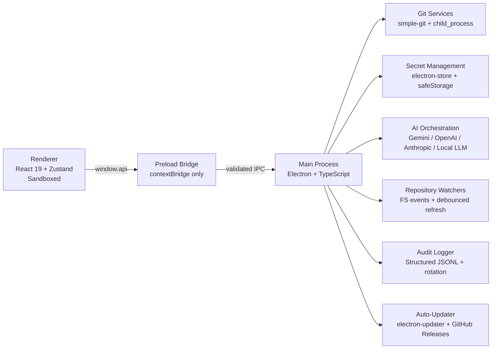

# Architecture Overview

GitSwitch is a security-first Electron desktop application for managing multiple Git repositories and developer identities. Built with React 19, TypeScript, Zustand, and Tailwind CSS, it enforces a strict privilege separation model: the renderer is treated as an untrusted sandbox, the preload layer exposes a minimal typed bridge, and the main process retains exclusive ownership of every filesystem, Git, network, and cryptographic operation.

This architecture directly addresses Electron's well-documented attack surface. Unlike web applications that run within a browser sandbox, Electron apps have access to Node.js APIs and the local filesystem. GitSwitch mitigates this by adopting the same zero-trust posture used in production Chromium: the renderer never receives elevated privileges, and every boundary crossing is validated. For a full enumeration of threats and mitigations, see [THREAT_MODEL.md](THREAT_MODEL.md). For reporting policies and a control summary, see [SECURITY.md](SECURITY.md).

## System Diagram

## Runtime Boundaries

GitSwitch partitions its codebase into three runtime layers. Each layer operates under a distinct trust level, and the boundaries between them are enforced by Electron's process isolation primitives.

### Renderer -- `src/renderer/src` (Untrusted)

The renderer is a sandboxed Chromium process that renders the application shell: repository sidebar, diff views, commit interface, settings panels, and pull-request workflows.

- **State management:** All UI state is held in Zustand stores. The renderer never caches decrypted secrets or raw filesystem paths beyond what the main process explicitly provides.
- **No direct privilege:** The renderer cannot access the filesystem, spawn child processes, invoke Git, or decrypt secrets. Every privileged action must cross the IPC boundary and survive validation in the main process.
- **Why this matters:** In a standard Electron app without these restrictions, a single XSS vulnerability in a diff view could escalate to full filesystem and shell access. By treating the renderer as untrusted, GitSwitch limits the blast radius of any renderer-side compromise to the UI layer alone.

### Preload Bridge -- `src/preload` (Narrow)

The preload script runs in a restricted context with `contextIsolation: true`. It uses Electron's `contextBridge` to expose a single `window.api` object to the renderer.

- **Typed surface:** Every method on `window.api` maps to a specific IPC channel. The TypeScript contract ensures the renderer can only invoke operations that the main process explicitly registers.
- **No passthrough:** The preload layer does not expose `ipcRenderer.send()` or `ipcRenderer.invoke()` directly. This prevents a compromised renderer from crafting arbitrary IPC messages.
- **Why this matters:** Many Electron security incidents stem from overly permissive preload scripts that leak Node.js primitives into the renderer. GitSwitch's preload bridge is intentionally narrow -- roughly 120 lines -- to minimize the attack surface at this critical boundary.

### Main Process -- `src/main` (Trusted)

The main process is the sole privilege holder. It validates every IPC input before dispatch, executes Git operations, manages pull requests across GitHub and GitLab, persists settings, coordinates repository watchers, handles secret encryption/decryption, and orchestrates AI commit generation.

- **Input validation:** Every IPC handler uses `assertString`, `assertNumber`, `assertBoolean`, and `assertKeys` to reject malformed payloads before any operation begins. Prototype pollution vectors (`__proto__`, `constructor`, `prototype`) are explicitly blocked.
- **Path normalization:** Repository paths are resolved with `realpath()` and checked for `..` traversal to prevent path escape attacks.
- **Repository access approval:** Before GitSwitch operates on any repository path for the first time, an explicit user dialog approval is required. This prevents a compromised renderer from silently targeting arbitrary directories.

## Key Subsystems

### Git Services -- `src/main/git/git-service.ts`

This module encapsulates all Git operations: status, diff, commit, fetch, pull, push, remote management, and `.gitignore` updates.

- **SSH key lifecycle:** When an operation requires SSH authentication, the key manager decrypts the relevant private key, writes it to a temporary file with `0600` permissions, uses it for the single operation, and removes it immediately in a `finally` block. The key material is zeroed from memory after the temp file is created. This minimizes the window during which plaintext key material exists on disk or in process memory.
- **Diff size limits:** Before transmitting diff content across IPC, the service checks payload size (hard limit of 512 KB) and file count. This protects the Electron event loop from blocking on oversized serialization and prevents the renderer from being overwhelmed by monorepo-scale changes.
- **Command injection prevention:** `simple-git` handles argument escaping for standard operations. For `pushWithIdentity`, GitSwitch uses `spawn()` with an argument array (no shell interpolation). Remote URLs are validated to accept only `git@`, `https://`, and `ssh://` prefixes. Branch names are validated against control characters, `..`, spaces, and shell metacharacters. See [T3 in the threat model](THREAT_MODEL.md#t3-command-injection-via-git) for the full analysis.

### Secret Management -- `src/main/secure/key-manager.ts`

GitSwitch uses a layered encryption strategy to protect SSH keys, API tokens, and provider credentials at rest.

- **Encryption:** Private keys and tokens are encrypted using Electron's `safeStorage` API, which delegates to the operating system's native keychain (macOS Keychain, Windows Credential Manager, or libsecret on Linux). Encrypted blobs are written to `~/.gitswitch/keys/*.enc`.
- **Metadata separation:** Non-sensitive metadata (key names, creation timestamps, associated identities) is stored in `electron-store`. The encrypted key material and the metadata store are kept separate so that a compromise of the configuration file does not expose secrets.
- **Renderer isolation:** The renderer only receives boolean presence flags (`hasAiKey`, `hasGitHubToken`, `hasGitLabToken`). Decrypted secrets never cross the IPC boundary.
- **Audit trail:** Every key access, save, and delete operation is recorded in the structured audit log, providing a forensic trail for security reviews. See [Audit Logging](#audit-logging----srcmainauditaudit-loggerts) below.

### AI Commit Generation -- `src/main/ai`

GitSwitch supports multi-provider AI-assisted commit message generation: Google Gemini, OpenAI, Anthropic, local LLM endpoints (via OpenAI-compatible APIs), and an offline heuristic generator.

- **Privacy-by-design consent model:** Cloud AI providers are never contacted unless the user has explicitly opted in via the `aiCloudConsented` setting. This consent gate is enforced at the orchestration layer before any network call is made, not in the UI alone.
- **Data redaction:** When `aiRedactionEnabled` is active, a redaction pass strips emails, URLs, AWS access keys, and common token patterns from diff content before it leaves the machine. This reduces the risk of inadvertent secret leakage to third-party AI APIs.
- **Diff truncation:** The amount of diff data sent to any AI provider is bounded by configurable kilobyte and line-count limits. This serves dual purposes: controlling API costs and limiting data exposure.
- **Hallucination detection:** AI responses are validated to ensure they do not reference files absent from the provided diff context, reducing the risk of misleading commit messages.
- **Rate limiting:** Requests are capped at 15 per minute to prevent abuse and runaway API costs.
- **Local-first option:** The local LLM path keeps all data on-device, with SSRF protections on the configurable endpoint URL. See [T9 in the threat model](THREAT_MODEL.md#t9-ssrf-via-local-llm-url) for details.

### Repository Watching -- `src/main/git/watcher.ts`

The file watcher subsystem keeps the UI synchronized with on-disk repository state without polling the filesystem continuously.

- **Debounced events:** Filesystem events are debounced at 500 ms to coalesce rapid changes (e.g., during a `git checkout` or build step) into a single status refresh.
- **Resource limits:** The watcher enforces a directory depth limit of 4, an expanded ignore list (skipping `node_modules`, `.git`, build artifacts, and other high-churn paths), and a maximum of 50 concurrent watchers with LRU eviction. These limits prevent resource exhaustion on large monorepos. See [T8 in the threat model](THREAT_MODEL.md#t8-denial-of-service) for the full set of DoS mitigations.
- **Error backoff:** After 5 consecutive errors, the watcher pauses for 30 seconds before retrying, preventing tight error loops from consuming CPU.
- **Remote reconciliation:** The renderer combines watcher events with an interval-based fetch loop (every 30 seconds) to detect remote changes and ahead/behind counts.

### Audit Logging -- `src/main/audit/audit-logger.ts`

GitSwitch maintains a structured audit trail of security-relevant events, supporting both operational debugging and compliance review.

- **Structured format:** Events are written as JSONL (one JSON object per line), enabling straightforward ingestion by log aggregation tools.
- **Automatic rotation:** Log files rotate at 5 MB to bound disk usage without requiring external log management.
- **Coverage:** Audit hooks are wired into key-manager operations (access, save, delete), AI commit generation, push, pull, and pull-request workflows. This provides visibility into the most sensitive operations the application performs.

### Auto-Update -- `src/main/auto-update.ts`

GitSwitch uses `electron-updater` to check GitHub Releases for new versions on a 4-hour interval after application startup.

- **User control:** When an update is available, an IPC notification is sent to the renderer so the user can review release notes and choose when to apply the update. Updates are never applied silently.
- **Distribution integrity:** macOS builds are code-signed and notarized. The auto-updater verifies signatures before applying updates, ensuring that only authentic releases are installed.

## Security Model Summary

GitSwitch's security posture is built on defense in depth. No single control is relied upon in isolation; each layer reinforces the others.

| Layer | Control | Purpose |
|-------|---------|---------|
| Process isolation | `sandbox: true`, `contextIsolation: true`, `nodeIntegration: false` | Confine renderer to UI-only capabilities |
| Content Security Policy | `script-src 'self'`, `frame-ancestors 'none'`, hardened link allowlist | Block XSS, clickjacking, and unauthorized navigation |
| IPC validation | Type assertions, key whitelisting, `assertKeys` prototype pollution guard | Reject malformed or malicious payloads at the boundary |
| Path security | `realpath()` normalization, `..` traversal blocking, access approval dialogs | Prevent directory escape and unauthorized repo access |
| Secret protection | `safeStorage` encryption, `0600` temp files, memory zeroing, presence-only flags | Keep key material away from renderer and minimize disk exposure |
| Network controls | SSRF validation, cloud AI consent gate, HTTPS enforcement, trusted-host allowlist | Prevent unauthorized outbound connections |
| Resource limits | Diff size caps, watcher depth/count limits, debouncing, rate limiting | Protect against denial of service and event loop blocking |
| Audit and update | Structured JSONL logging, signed auto-updates via `electron-updater` | Maintain forensic trail and deliver security patches |

For threat-by-threat analysis, see [THREAT_MODEL.md](THREAT_MODEL.md).

## Data Flow Example: Commit

This walkthrough illustrates how a commit request traverses all three runtime boundaries, demonstrating the validation and privilege separation in practice.

1. **Renderer:** The user writes a commit message and clicks "Commit." The renderer calls `window.api.gitCommit(repoPath, title, body)`.
2. **Preload:** The preload bridge forwards the call to the `git:commit` IPC channel. No transformation occurs -- the bridge is a passthrough with a typed contract.
3. **Main process -- validation:** The IPC handler validates `repoPath` (string, normalized, no traversal), `title` (string, within size limits), and `body` (string, within size limits). If any check fails, the handler returns a structured error without invoking Git.
4. **Main process -- execution:** `git-service.ts` runs the commit via `simple-git`. If SSH authentication is required, the key manager decrypts the relevant key, writes a `0600` temp file, configures `GIT_SSH_COMMAND`, and cleans up in a `finally` block.
5. **Main process -- audit:** The commit operation is recorded in the audit log with timestamp, repository path, and outcome.
6. **Renderer -- update:** The main process returns a structured result. The renderer refreshes status and diffs, then updates the UI.

## Operational Notes

- **Settings hydration:** Default settings are defined in the main process and mirrored during renderer hydration to prevent stale startup values and ensure the main process is always the source of truth.
- **Testing:** Coverage and test entry points are configured with Vitest (57 unit tests), including targeted tests for security helpers, input validation, and IPC contracts. End-to-end tests use Playwright.
- **Packaging:** Build metadata is maintained in `electron-builder.yml`, with macOS entitlements stored under `resources/`. Cross-platform packaging targets macOS (DMG), Windows (NSIS), and Linux (AppImage/DEB).
- **GDPR compliance:** GitSwitch is designed with privacy-by-design principles. User data stays local, cloud AI requires explicit consent, and audit logs can be inspected or deleted by the user at any time. See [PRIVACY.md](PRIVACY.md) for details.
