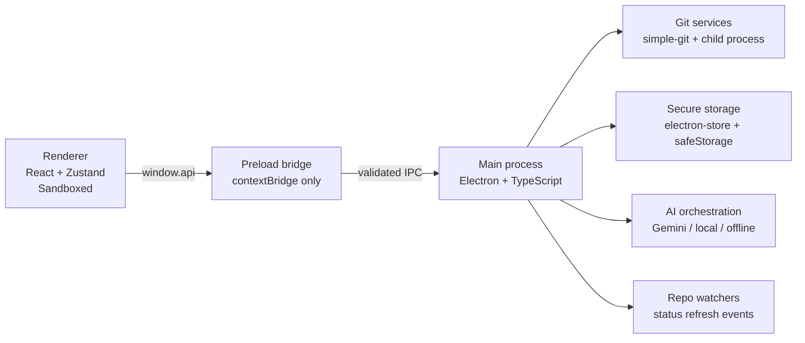

# Architecture Overview

GitSwitch follows a security-first Electron architecture: the renderer is treated as untrusted UI, the preload layer exposes a minimal typed bridge, and the main process owns every filesystem, git, network, and secret operation.

## System Diagram

## Runtime Boundaries

### Renderer: `src/renderer/src`

- Renders the application shell, repository sidebar, diff views, settings, and pull-request flows.
- Stores UI state in Zustand.
- Never touches the filesystem, shell, git, or decrypted secrets directly.

### Preload: `src/preload`

- Exposes the `window.api` surface.
- Translates renderer intent into specific IPC calls.
- Keeps the renderer contract typed and narrow.

### Main: `src/main`

- Owns all privileged work.
- Validates IPC inputs before dispatch.
- Executes git operations, manages pull requests, persists settings, handles watchers, and stores secrets.

## Key Subsystems

### Git Services

- `src/main/git/git-service.ts` encapsulates status, diff, commit, fetch, pull, push, remotes, and `.gitignore` updates.
- SSH key material is written to temporary `0600` files only when a command requires it, then removed immediately.
- Diff responses are size-limited before crossing IPC to protect the Electron event loop and the renderer.

### Secret Management

- `src/main/secure/key-manager.ts` stores non-sensitive metadata in `electron-store`.
- Private keys and tokens are encrypted with `safeStorage` and written beneath `~/.gitswitch/keys`.
- The renderer only receives presence flags such as `hasAiKey` or `hasGitHubToken`.

### AI Commit Generation

- AI orchestration lives under `src/main/ai`.
- The current product surface supports offline generation, local LLM endpoints, and cloud Gemini models.
- Prompt input is redacted before it leaves the machine when redaction is enabled. The redaction pass covers emails, URLs, and AWS key patterns.
- Cloud AI modes require explicit user consent before any data is sent off-device.

### Repository Watching

- `src/main/git/watcher.ts` emits repo status updates to the active window.
- File-system events are debounced at 500ms to avoid overwhelming the renderer.
- The watcher enforces a directory depth limit of 4 and an expanded ignore list to skip `node_modules`, `.git`, build artifacts, and other noisy paths.
- The renderer combines those events with an interval-based fetch loop for remote reconciliation.

### Audit Logging

- `src/main/audit/audit-logger.ts` writes structured JSONL entries for security-relevant events.
- Log files rotate automatically at 5MB to bound disk usage.
- Audit hooks are wired into key-manager operations, commit generation, push, pull, and pull-request flows.

### Auto-Update

- `src/main/auto-update.ts` uses `electron-updater` to check GitHub Releases for new versions.
- Update checks run on a 4-hour interval after application startup.
- When an update is available, an IPC notification is sent to the renderer so the user can review and apply the update.

## Security Model

- `sandbox: true`, `contextIsolation: true`, `nodeIntegration: false`
- Strict production CSP with `frame-ancestors 'none'` and hardened external link allowlist
- SSRF validation on `aiLocalUrl` before any request is issued to a local LLM endpoint
- Input validation on every IPC route; prototype pollution blocked via `assertKeys`
- No direct secret exposure to the renderer
- Cloud AI consent gate prevents off-device data transmission without explicit approval
- Graceful shutdown guard ensures secrets and temporary files are cleaned up on quit
- Repository access approval before operating on a path

## Data Flow Example

1. The renderer requests `window.api.gitCommit(repoPath, title, body)`.
2. Preload forwards the call to the `git:commit` IPC channel.
3. The main process validates the path and message payload.
4. `git-service.ts` executes the commit and returns a structured result.
5. The renderer refreshes status and diffs, then updates the UI.

## Operational Notes

- Default settings are defined in the main process and mirrored in renderer hydration to avoid stale startup values.
- Coverage and test entry points are configured with Vitest, including targeted tests for security helpers.
- Packaging metadata is maintained in `electron-builder.yml`, with macOS entitlements stored under `resources/`.
